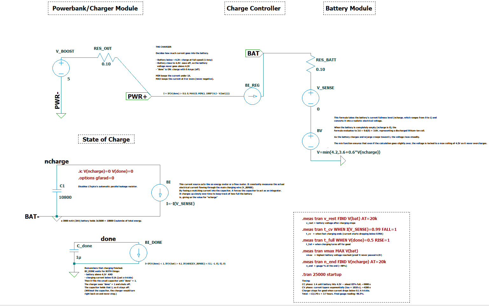
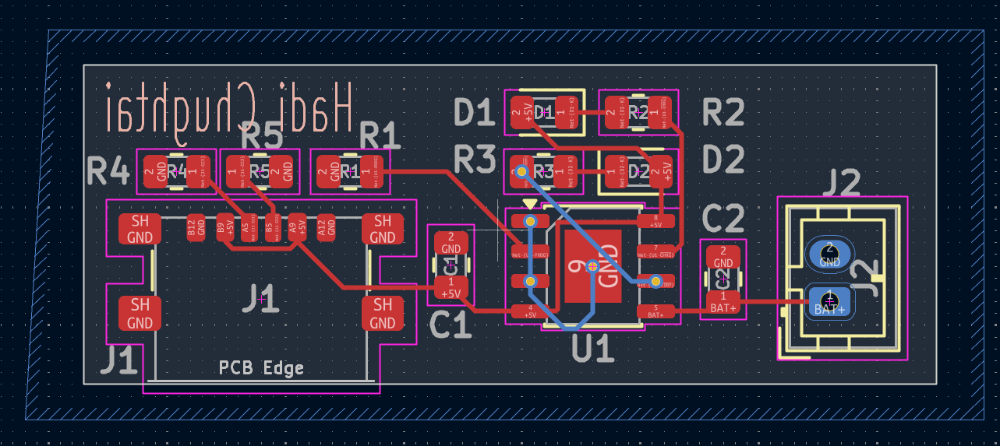
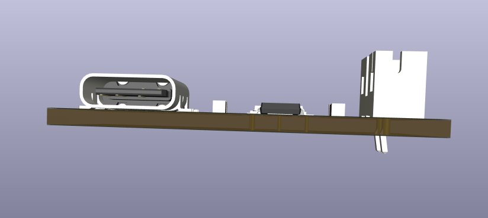

# TP4056 USB-C Lithium-Ion Charger PCB

This is a KiCad project for a small printed circuit board that charges a single lithium-ion cell from USB-C.

It started as a battery charger I built in LTspice. That circuit was only a simulation — every part in it was fake, just math that acted like a charger. This project turns that simulation into a real board design with real parts that can be bought and soldered.

> This board is a finished design, but it has not been ordered, assembled, or tested yet. The design files are fabrication-ready.

The goal was simple, and I set it at the start:

- take the LTspice circuit and turn it into a board that could actually be made,
- keep it simple and easy to follow,
- list the real parts needed and how each one connects,
- and do the full PCB layout, not just the schematic.

This was my first PCB. I picked this project on purpose: I wanted to learn the whole process (simulation, schematic, footprints, layout, checking, factory files) on a circuit I already understood, instead of copying a tutorial board that means nothing to me.

Where it ended up: a finished two-layer board, 36 mm × 13.5 mm, that charges one Li-ion cell at 1 A from USB-C, with a red light for "charging" and a green light for "done." The schematic check came back clean, the layout check came back with zero errors and nothing left unconnected, and the factory files are made and checked.


## Where It Started: The LTspice Simulation

The LTspice circuit was not made of real parts. Each block just acted out one job of a charger:

- **A 5 V source** — pretending to be a USB power supply.
- **A fake regulator** — a math block that pushed exactly 1 A into the battery at first, then less and less as the battery filled up. You cannot buy this. It only exists inside the simulation.
- **A fake battery** that acted like a 3,000 mAh cell getting fuller.
- **A charge counter** built around a huge 10,800 F capacitor. 10,800 is not a random number: a 3,000 mAh battery holds 10,800 coulombs of charge, so this capacitor "counted" how much charge had gone into the battery.
- **A "done" switch** that stopped the charge once the battery was over 4.1 V and the current had dropped under 100 mA, and stayed off.

The full simulation is in my [CC/CV charger simulation](https://github.com/Hadi-Chughtai/CC-CV-Simulation) project.



So the spec the real board had to match was:

```text
Charge at 1.0 A at first (constant current).
At 4.2 V, hold the voltage and let the current drop on its own (constant voltage).
Stop at 100 mA — one tenth of the starting current — and show "done."
Battery: one 3.7 V Li-ion/LiPo cell, 3,000 mAh.
```

## The Main Idea

Most of the LTspice circuit should not be on the board at all. The regulator, the fake battery, the charge counter, and the done switch were only there to make the simulation behave. Real hardware does not need them, because one cheap chip already does all of that by itself: the TP4056.

It charges at a set current (up to 1 A), holds 4.2 V at the end, stops on its own when the current drops to a tenth, and has two pins that can light an LED to say "charging" or "done." That is exactly what my simulation did, which is why I picked it.

So the real work was translation. Go through the simulation one block at a time and ask: in real life, what part does this job? And if the answer is "nothing — that was only there for the simulation," delete it.

## How Each Part of the Simulation Became a Real Part

- **5 V ideal source → J1, a USB-C socket (power-only type).** A real board needs a real plug for power. USB-C because every cable on my desk is USB-C.
- **Nothing in the simulation → R4 and R5, two 5.1 kΩ resistors on the socket's CC1 and CC2 pins.** A USB-C power supply gives out nothing until it sees these two resistors. They are how the board "asks" for power. The simulation never needed them because its 5 V source was always on.
- **The fake regulator (1 A, then taper at 4.2 V) → U1, the TP4056 charger chip.** This one chip does the whole charging job the fake block was acting out.
- **The charge current, which was just a number inside the fake block → R1, a 1.2 kΩ resistor on the chip's PROG pin.** On the real chip, one resistor sets the charge current. 1.2 kΩ = 1 A, the same current my simulation used.
- **The fake battery → J2, a 2-pin JST-PH socket (pin 1 = BAT+, pin 2 = GND).** The fake battery becomes a real battery that stays off the board and plugs in. JST-PH is the plug that real LiPo pouch batteries come with.
- **The charge counter (10,800 F capacitor) → nothing. Deleted.** It only existed so the simulation could count charge. The real chip knows when to stop by itself, so no part is needed.
- **The "done" switch → the chip's STDBY pin (pin 6), through R3 (1 kΩ), to D2, a green LED.** When the chip finishes charging, this pin turns the green "done" LED on. Same job as the fake switch, done by the chip.
- **Nothing in the simulation → the chip's CHRG pin (pin 7), through R2 (1 kΩ), to D1, a red LED.** Added for the real board: a red "charging" light, so the board tells you what it is doing instead of you watching a graph.
- **Nothing — fake parts do not need it → C1 and C2, two 10 µF capacitors,** one on the +5V input and one on the battery side. Real chips need a capacitor close by to stay stable. The simulation hid this completely.
- **Setup pins → the chip's TEMP pin (pin 1) wired to GND, and its CE pin (pin 8) wired to +5V.** Grounding TEMP turns off temperature sensing (I did not use a temperature sensor), and CE to +5V means "always on when plugged in."
- **Ground → a sheet of copper covering both sides of the board,** not single wires. Explained further down.

## Charge Current

The charge current is set by R1 on the PROG pin. For the TP4056, the relationship is:

```text
Charge current (mA) = 1200 / R1 (kΩ)
```

In this design:

```text
R1 = 1.2 kΩ
1200 / 1.2 = 1000 mA
```

So the board charges at:

```text
1 A
```

The status pins work by connecting to ground when they are on, so each LED sits between +5V and its pin, with a 1 kΩ resistor (R2, R3) to limit the current. With about 2 V across the LED:

```text
LED current ≈ (5 V - 2 V) / 1000 Ω = 3 mA
```

## Decisions I Made, and Why

1. **Use my own simulation instead of a tutorial board.** I had looked at tutorial boards first and dropped them — they felt random and I would not use them for anything. Bigger boards (a buck converter, a motor driver, a microcontroller board) were honestly too hard for a first PCB. This way the circuit was already in my head and the only new thing to learn was PCB design itself.
2. **One chip (TP4056) does all the charging.** It matches my simulation's numbers exactly, it only needs a few parts around it, and it is a common, proven chip.
3. **USB-C for power in, the power-only version of the socket.** USB-C is what I actually have cables for. The power-only socket has no data pins, which kept the schematic simple. The cost of that choice is the two CC resistors — worth it, and I learned something real from them.
4. **1.2 kΩ for R1.** That sets 1 A, the same as my simulation, and 1 A suits a 3,000 mAh cell and most medium-size pouch batteries.
5. **An LED on each status pin, each with a 1 kΩ resistor.** Red = charging, green = done.
6. **0805 size for all the small parts.** It is the biggest common surface-mount size, so if I solder this by hand later, it is the easiest size to work with.
7. **TEMP pin to ground, CE pin on.** The simplest setup that is still correct: no temperature sensor, charger runs whenever it is plugged in.
8. **All parts on the front of the board.** The USB-C socket only mounts on top, and the LEDs need to face up so you can see them. Keeping every part on one side also makes soldering simpler. The back of the board is still used — for the ground copper and for one track that needed to cross.
9. **Route the tracks by hand, not with an autorouter.** The board only has 7 nets, doing it myself kept the two power tracks wide, and routing it myself was the skill I was trying to learn.
10. **No warnings at all, not just no errors.** When the board check reported warnings about the printed labels, I decided I wanted the report completely empty, not just "good enough." How that was done is in the checking section below.
11. **Stop at the design — do not order it yet.** I priced it up: the boards themselves are only about $2–4, but fast shipping was $25, slower shipping about $9, and a US maker (OSH Park) would be $3.76 for three boards. There is no deadline forcing my hand, so I kept the finished, checked design and left ordering as something I can do any time with one upload.

## Step 1: The Schematic

I placed the 12 real parts in KiCad's schematic editor — the chip (U1), the two sockets (J1, J2), five resistors, two capacitors, and two LEDs — and wired them up following the translation list above. Checking the schematic properly caught mistakes that looking at it had not:

- **Parts sitting next to each other are not the same as parts connected.** In my first attempt, several wires only looked joined. I went back through the connection list one wire at a time until every join was real.
- **PROG, CC1, and CC2 were wrong at first.** I had wired them straight to ground. They have to go through their resistors — the resistor is the whole point of those pins. Fixed by routing each one through R1, R4, and R5.
- **Both LEDs were in backwards.** The chip's status pins connect to ground when they turn on, so the LED has to face +5V, not the chip. I flipped both LEDs and checked again.
- **Things were missing.** The battery socket, the USB socket's ground and shield connections, and the part values all had to be added before the schematic was actually complete.
- **The schematic check (ERC) reported two errors at the end:** "power pin not driven" on +5V and GND. That error is normal for this board — the power comes in through a passive USB socket, so there is no power source on the board for the checker to see. The fix is two PWR_FLAG symbols, which just tell the checker "this net is powered from outside, on purpose."

Result of this step: ERC fully clean, and every value set:

```text
R1 = 1.2 kΩ
R2 = 1 kΩ
R3 = 1 kΩ
R4 = 5.1 kΩ
R5 = 5.1 kΩ
C1 = 10 µF
C2 = 10 µF
```


## Step 2: Footprints

A footprint is the pattern of metal pads a part solders onto, so each schematic part needed the right one. All the small parts got 0805 footprints so the board stays easy to solder by hand. The two sockets got footprints made for those exact parts:

```text
U1       HSOP-8 with a ground pad underneath (3.9 × 4.9 mm)
J1       Made for the exact GCT USB4135-GF-A socket, top-mount, 6-pin
J2       JST PH vertical, 2.00 mm pitch
R1–R5    0805
C1–C2    0805
D1–D2    0805, with the polarity marked
```

One mistake here: the LEDs briefly had the capacitor footprint. I caught it in the assignment list and changed both to the LED footprint, which matters because LEDs have a right way round and the LED footprint marks it.

One thing to remember from this step: the USB socket footprint fits one exact part (GCT USB4135-GF-A), so that is the part to buy if the board gets built.

## Step 3: Placing the Parts and the Board Outline

KiCad turns the schematic into a pile of footprints joined by thin lines (the ratsnest) showing what has to connect to what. I placed the parts so the power flows left to right, the same way the circuit reads: USB socket on the left edge, the chip in the middle, its input capacitor (C1) just left of it and battery capacitor (C2) just right of it, and the battery socket on the right edge. R4 and R5 sit right above the USB socket's CC pins, and R1 and the LED parts sit above the chip, near the pins they connect to.

My first placement put the battery socket on the far left, which would have dragged the BAT+ track across the whole board, and a couple of parts were hanging off the board edge — I scrapped that layout and redid it the way described above.

The outline is a rectangle drawn on the Edge.Cuts layer. Its bottom edge sits exactly on the USB socket's own "PCB Edge" line, so the socket ends up flush with the edge of the board, like a port on a real product. The other three sides have about 3 mm of spare room. Final size:

```text
36 mm × 13.5 mm, 1.6 mm thick
```

Roughly the footprint of a AA battery, but flat.

## Ground Is a Sheet of Copper, Not Wires

Instead of drawing ground wires, I drew a copper zone over the whole board and told it "you are GND." Every ground pad touches that copper, so ground connects itself.

My first try only filled the bottom layer, which does not work on its own — the parts sit on top, so their ground pads are on the top layer. Once the zone was set to both layers and refilled, almost every ground line in the ratsnest disappeared in one go.

## Routing the Tracks by Hand

Seven nets were left to route. I did them on the top layer, in this order, on purpose:

```text
Widths: 0.5 mm for the two tracks that carry the full 1 A (+5V in, and BAT+)
        0.25 mm for everything else
Order:  BAT+ first, then +5V, then the two short CC tracks,
        then PROG, then the two LED chains last
```

BAT+ came out as one straight line from the chip, through C2, to the battery socket. The +5V track joins the USB socket's two power pins, then C1, then the chip.

The one crossing problem: the green LED's track (STDBY) had to get from above the chip to pin 6 on the chip's other side, and every top-layer path crossed something else. Instead of going the long way around the edge of the board, I dropped it through a via (a small plated hole) to the back layer, ran it under the chip, and came back up through a second via into pin 6. The back track passes under the chip's ground pad in the top view, which is fine — the board itself is the insulation between the layers. This was the first time I used vias to route, not just to connect ground.

Moving parts to the back is a common trick to untangle a layout. I looked at it and did not use it, for the reasons in decision 8.







## Step 4: Checking the Board (DRC)

The first full check (DRC) reported 21 problems plus 2 unconnected pads. That sounds bad, but reading them one by one, they were really three real problems and a pile of cosmetic ones:

- **U1 pins 1 and 3 (both GND) not connected properly — 3 errors.** Those two ground pins were boxed in by the STDBY via and the PROG track, so the ground copper could not reach them properly. Fix: vias placed in the pins themselves, tying pins 1 and 3 and the chip's big centre ground pad straight into the bottom copper, which was well connected.
- **Board outline is malformed (crosses itself) — 1 error.** My outline edit had left overlapping outline shapes. Cleaned it back to one rectangle and re-ran the check — gone.
- **Printed labels (silkscreen) sitting on pads or on other parts' outlines — 19 warnings.** Cosmetic only — the factory just does not print the parts of a label that fall on a pad. Since I wanted a completely empty report, I removed them all at once: one bulk edit moved every part label off the printing layer onto the Fab layer. The labels are still there in KiCad when I need them for soldering; they just will not be printed.
- **Two drill holes in exactly the same place (at U1 pin 3) — 1 warning, showed up on the re-check.** The pin-3 fix had left two identical vias stacked in one spot. Deleted one and checked the pin was still connected.

Final check:

```text
0 errors, 0 warnings, 0 unconnected pads
```

Everything in the layout is connected the way the schematic says.

There was one more check after that, at the factory's website. Their preview of the back of the board looked wrong to me at first — nearly all plain green, with one diagonal line. I went through it item by item and it was right: the back is ground copper covered by the green coating, so it looks blank; the two pads you can see are the battery socket's pins from behind, which is why they are on the opposite side; and the diagonal line is my STDBY track on the back — it slopes the other way because you are looking at the board from the other side, like a reflection. Their system also read the board size back as 13.5 × 36 mm and 2 layers, which matched my outline exactly.

## Step 5: The Files a Factory Needs

A factory does not take the KiCad file. It takes Gerber files — one file per layer (top copper, bottom copper, the green coating layers, the printing layers, the paste layers, and the board outline) — plus drill files that say where every hole goes.

I exported all of them and then opened the zip and checked it file by file before uploading: 12 files, and in particular both drill files were in there. Without the drill files the board would come back with no holes in it.

I also put my name on the board: printed text on the back, in the big empty area, with a title and version line under it ("TP4056 USB-C Li-Ion Charger · Rev 1 · 2026"). Text on the back looks backwards in the editor, because you are looking through the board — on the real board, flipped over, it reads normally.

## How You Would Actually Use It

The board does not hold a battery and nothing slots into it. It sits between a power supply and a battery, like an adapter.

A USB-C cable plugs into the left end, the same as plugging a cable into a phone. The battery is a flat silver pouch with a red wire and a black wire already attached, ending in a small white plug — that plug pushes into the white socket on the right end of the board, and the battery just lies next to the board on the desk. Inside the plug, the red wire lands on pin 1 (BAT+) and the black wire on pin 2 (GND). The plug only fits one way round, but it is still worth one look before the first use, because a few batteries are wired the other way round and that would damage the chip.

Red light on means it is charging. Green light on means the battery is full and the charger has stopped by itself — unplug it and use the battery. The chip gets warm while charging at 1 A, which is normal for this chip.

## Final Specs

```text
What it does:   Charges one Li-ion/LiPo cell. Charging only — nothing else.
Power in:       USB-C, 5 V. Best from a wall adapter, not a laptop port.
How it charges: 1.0 A until the cell reaches 4.2 V, then holds 4.2 V
                while the current drops, and stops at 100 mA.
Lights:         Red LED on = charging. Green LED on = finished.
Battery:        JST-PH 2-pin plug (pin 1 = BAT+, pin 2 = GND).
                The battery is not on the board — it plugs in and sits next to it.
Board:          2 layers, 36 × 13.5 × 1.6 mm, ground copper on both sides.
Parts:          12, all surface-mount, all on the front.
Checks:         Schematic check clean.
                Layout check: 0 errors, 0 warnings, 0 unconnected.
```

## Parts List

```text
U1       1×  TP4056 chip — does all the charging
J1       1×  USB-C socket, GCT USB4135-GF-A (power-only) — where the 5 V comes in
J2       1×  JST-PH 2-pin socket — where the battery plugs in
R1       1×  1.2 kΩ, 0805 — sets the charge current to 1 A
R2, R3   2×  1 kΩ, 0805 — one for each LED, to limit its current
R4, R5   2×  5.1 kΩ, 0805 — the USB-C CC resistors
C1, C2   2×  10 µF, 0805 — one on the input, one on the battery side
D1       1×  Red LED, 0805 — "charging" light
D2       1×  Green LED, 0805 — "done" light
```

## Files in This Repo

```text
kicad/        schematic and PCB layout (made in KiCad 10)
fabrication/  Gerber and drill files, plus a zip ready to upload to a fab house
images/       the LTspice simulation, schematic, layout, and 3D views of the board
```

## Limitations

This project is a board design. It shows the charger design and that the design passes KiCad's checks, but the board itself has not been built yet.

It does not include:

- an assembled or tested board,
- battery temperature sensing (the TEMP pin is grounded),
- a protection circuit or a power output — it only charges, and the battery comes off the charger to be used somewhere else,
- charging for more than one cell, or for anything other than a single 3.7 V Li-ion/LiPo cell,
- or USB data / fast-charge negotiation — the input is always 5 V.

The charge current is also fixed by R1. Changing the 1 A charge rate means changing that resistor value in the design.

If I do order it later, everything is ready: order the boards, buy the 12 parts on the list above — including the exact GCT USB socket the footprint needs — solder them on, and test it with a real battery: red light when it is plugged in, green light at 4.2 V. At that point this page gets one new line: built and tested.

Next board I have planned: an LM358 op-amp amplifier (the gain is set by a knob — a 100 kΩ potentiometer — from 1× to 11×, running on 9 V). Same process, an analogue circuit this time.
