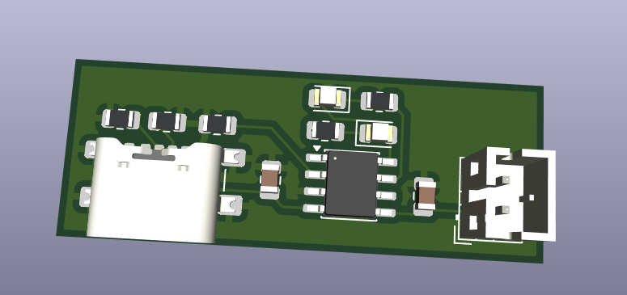
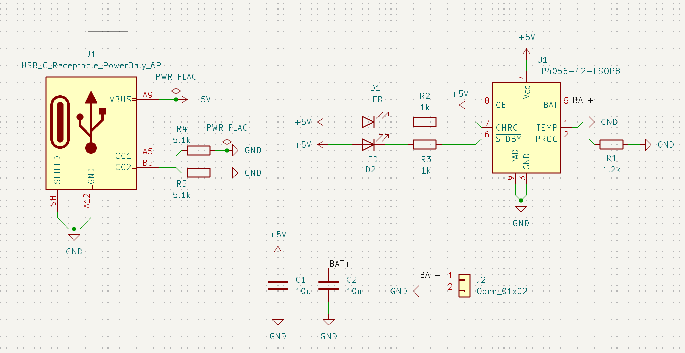

# TP4056 USB-C Lithium-Ion Charger PCB

This is a KiCad project for a small printed circuit board that charges a single lithium-ion cell from USB-C.

The board uses a TP4056 charger chip. It takes 5 V in from a USB-C connector, charges the cell at about 1 A while the cell is low, and then reduces the charging current as the cell gets close to 4.2 V.

This is the hardware version of my [CC/CV charger simulation](https://github.com/Hadi-Chughtai/CC-CV-Simulation). In the simulation, the constant-current / constant-voltage behavior was built out of separate behavioral blocks. On this board, the TP4056 does that same job inside one chip.

> This board is a finished design, but it has not been ordered, assembled, or tested yet. The design files are fabrication-ready.

The goal was to turn the simulated charger into a real board design:

- charge a single lithium-ion cell from a USB-C 5 V supply,
- hold about 1 A while the cell is still low,
- taper the current as the cell approaches 4.2 V,
- show charging and charge-done states with LEDs,
- and keep the board small and hand-solderable.



## USB-C Input

The USB-C connector (J1) is power-only. It has 6 pins and carries no data.

A USB-C power supply only outputs 5 V if it sees pull-down resistors on the CC pins. Those are R4 and R5:

```text
R4 = 5.1 kΩ
R5 = 5.1 kΩ
```

These resistors tell the supply that the board is a device that wants 5 V.

## Charger Chip

U1 is a TP4056 charger chip in an ESOP-8 package.

It handles both charging stages by itself:

```text
Constant-current stage:
Current is held near 1 A while the cell voltage is low.

Constant-voltage stage:
Current tapers down as the cell voltage approaches 4.2 V.
```

When charging is finished, the chip stops and changes the state of its two status pins, which drive the LEDs.

## Charge Current

The charge current is set by one resistor, R1, on the PROG pin of the chip.

For the TP4056, the relationship is:

```text
Charge current (mA) = 1200 / R1 (kΩ)
```

In this design:

```text
R1 = 1.2 kΩ
1200 / 1.2 = 1000 mA
```

So the board charges at:

```text
1 A
```

## Status LEDs

The chip has two status outputs, CHRG and STDBY.

- One LED (D1) is on while the cell is charging.
- The other LED (D2) is on when charging is done.

R2 and R3 limit the LED current. Each one is:

```text
R2 = 1 kΩ
R3 = 1 kΩ
```

With a 5 V supply and about 2 V across the LED, the LED current is about:

```text
(5 V - 2 V) / 1000 Ω = 3 mA
```

## Capacitors

There are two capacitors, both 10 µF:

```text
C1 = 10 µF   on the 5 V input side
C2 = 10 µF   on the battery side
```

They keep the input voltage and the battery-side voltage stable while charging.

## Battery Connection

The battery connects through J2, a 2-pin JST PH connector.

The TP4056 also has a TEMP pin for battery temperature sensing. In this design it is connected straight to ground:

```text
TEMP -> GND
```

This disables temperature sensing. The charger does not check how hot or cold the cell is while it charges.

## Board Layout

The finished board is:

```text
Size:      36 mm × 13.5 mm
Layers:    2
Thickness: 1.6 mm
```

All of the resistors, capacitors, and LEDs are 0805 size, so the board can be soldered by hand.

Before exporting the fabrication files, the design was checked:

```text
Schematic ERC: no errors
Layout DRC:    0 errors, 0 unconnected nets
```




## Parts List

```text
U1       TP4056-42 charger chip (ESOP-8)
J1       USB-C receptacle, power-only, 6-pin
J2       JST PH battery connector, 2-pin
R1       1.2 kΩ, 0805 — sets the charge current
R2, R3   1 kΩ, 0805 — LED resistors
R4, R5   5.1 kΩ, 0805 — USB-C CC pull-downs
C1, C2   10 µF, 0805 — input and battery capacitors
D1, D2   LED, 0805 — charging / charge-done indicators
```

## Files

```text
kicad/        schematic and PCB layout (made in KiCad 10)
fabrication/  Gerber and drill files, plus a zip ready to upload to a fab house
images/       schematic, layout, and 3D views of the board
docs/         longer write-up of the project (PDF)
```

## Limitations

This project is a board design. It shows the charger design and that the design passes KiCad's checks, but the board itself has not been built yet.

It does not include:

- an assembled or tested board,
- battery temperature sensing (the TEMP pin is grounded),
- charging for more than one cell,
- or USB data / fast-charge negotiation — the input is always 5 V.

The charge current is also fixed by R1. Changing the 1 A charge rate means changing that resistor value in the design.
