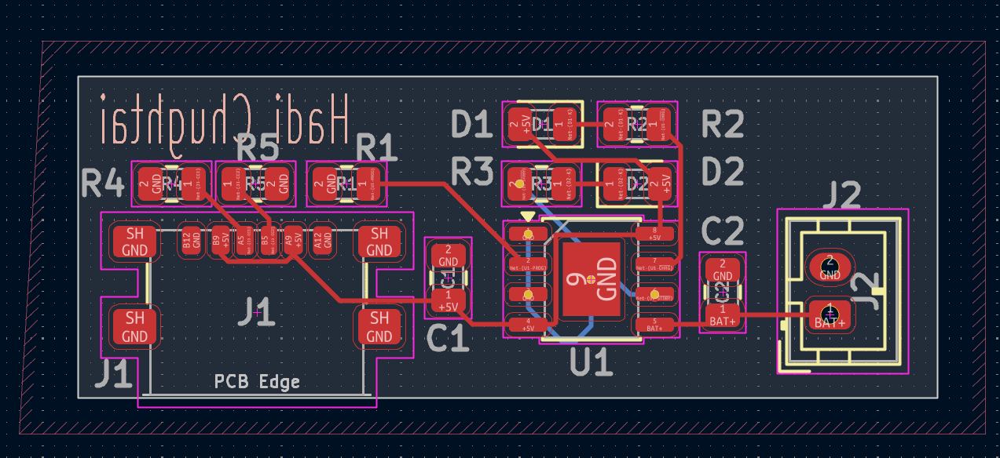
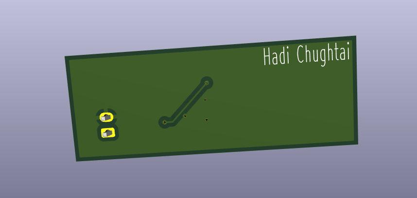

# USB-C Li-Ion Charger PCB

A small single-cell Li-ion charger board I designed in KiCad. It takes 5 V from USB-C and charges one Li-ion cell at 1 A up to 4.2 V using a TP4056 charger IC.

This started as an LTspice simulation of a CC/CV charger. In the simulation I had to build the constant-current / constant-voltage behavior out of separate blocks. On the real board the TP4056 does that whole job in one chip, so the PCB version ends up much simpler than the simulation it came from.

## Specs

- **Input:** USB-C, 5 V
- **Charge current:** 1 A, set by R1 (1.2 kΩ on the PROG pin)
- **Charge voltage:** 4.2 V, standard TP4056 CC/CV profile
- **Status LEDs:** one for charging, one for charge done
- **Board size:** 36 mm × 13.5 mm, 2 layers, 1.6 mm thick
- **Packages:** all passives are 0805, so the board can be hand-soldered
- **Checks:** schematic ERC clean; layout DRC finished with 0 errors and 0 unconnected nets

## Design notes

- The USB-C connector is power-only. Two 5.1 kΩ resistors on the CC pins (R4, R5) tell the power supply to output 5 V.
- The TP4056 TEMP pin is tied to ground, so battery temperature sensing is disabled.
- 10 µF capacitors sit on both the input side and the battery side of the charger IC.
- The battery connects through a 2-pin JST PH connector (J2).

## Status

Design only for now. The board is fabrication-ready — the Gerber and drill files are in `fabrication/` — but I have not ordered, assembled, or tested it yet.

## Files

- `kicad/` — schematic and PCB layout (made in KiCad 10)
- `fabrication/` — Gerber and drill files, plus one zip ready to upload to a fab house
- `images/` — schematic, layout, and 3D views of the board
- `docs/` — a longer write-up of the project (PDF)

## Bill of materials

| Ref | Part | Value / notes |
| --- | --- | --- |
| U1 | TP4056-42 charger IC | ESOP-8 package with exposed pad |
| J1 | USB-C receptacle | Power-only, 6-pin (GCT USB4135 footprint) |
| J2 | Battery connector | JST PH, 2-pin, vertical |
| R1 | Resistor, 0805 | 1.2 kΩ — sets the 1 A charge current |
| R2, R3 | Resistor, 0805 | 1 kΩ — LED current limit |
| R4, R5 | Resistor, 0805 | 5.1 kΩ — USB-C CC pull-downs |
| C1, C2 | Capacitor, 0805 | 10 µF — input and battery side |
| D1, D2 | LED, 0805 | Charging / charge-done indicators |
